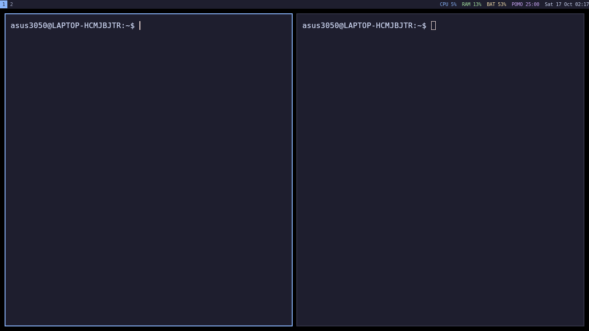
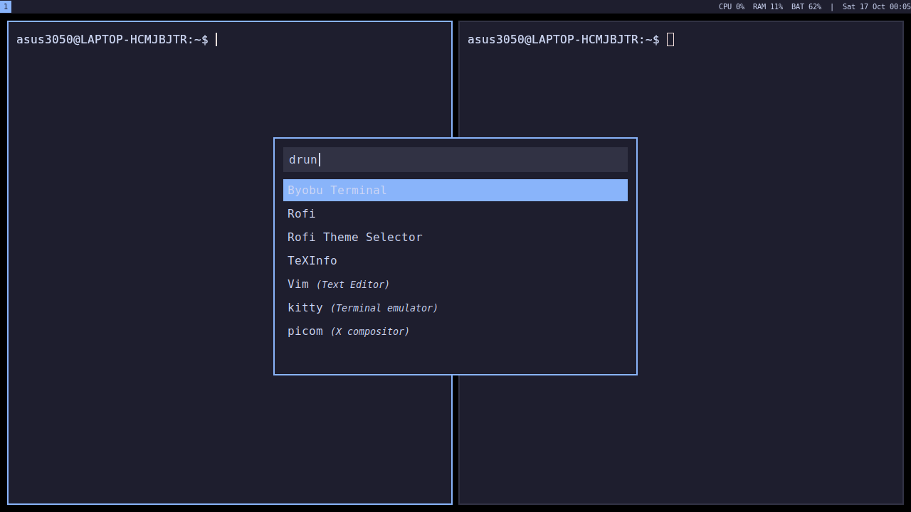
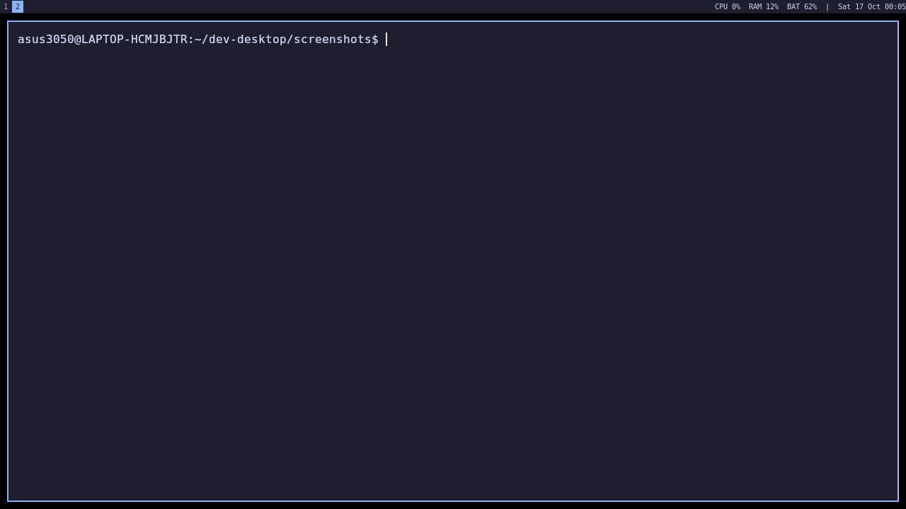
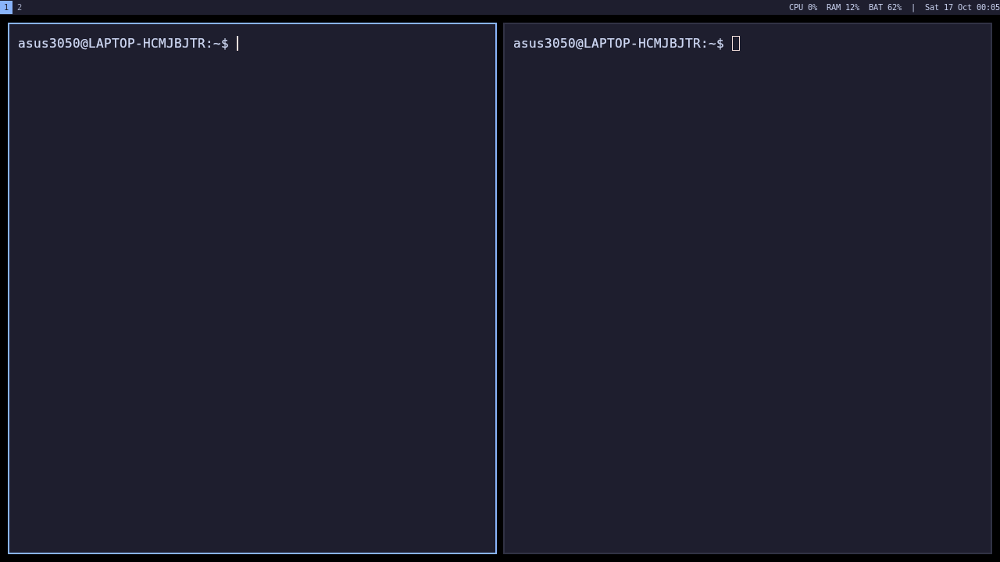

# dev-desktop

A keyboard-driven developer desktop built on **i3**, **Kitty** and **Rofi** with a
consistent **Catppuccin Mocha** theme across the window manager, status bar, terminal
and launcher. A small shell pipeline shows live CPU, RAM and battery stats in the bar,
falls back to disk usage when no battery exists, and exposes every widget as a
clickable i3bar block.

## Screenshots






## Setup

Requires Ubuntu / Debian (including WSL2 with Xephyr).

```bash
git clone https://github.com/waffleslately/dev-desktop.git
cd dev-desktop
./install.sh
```

`install.sh` installs `i3 kitty rofi scrot feh imagemagick vim xserver-xephyr`,
copies every script to `~/.local/bin/`, copies every config to `~/.config/`, and
creates `~/notes.md`.

### Running in WSL2 (Xephyr)

```bash
Xephyr :1 -screen 1280x720 &
DISPLAY=:1 i3
```

> **Note**: WSLg sets `WAYLAND_DISPLAY`, which makes GUI apps abort.
> Every app launcher in the config already prefixes `env -u WAYLAND_DISPLAY`.
> Kitty also needs `LIBGL_ALWAYS_SOFTWARE=1` because WSL2 has no direct GPU in Xephyr.

## Structure

| Path | Purpose |
|---|---|
| `config/i3/config` | Window manager – theme, keybinds, bar, assign rules |
| `config/kitty/kitty.conf` | Terminal – Catppuccin Mocha colours |
| `config/rofi/catppuccin.rasi` | Launcher – Catppuccin Mocha theme |
| `scripts/sysinfo.sh` | Print CPU, RAM and battery (or disk); supports `cpu\|ram\|bat` arg |
| `scripts/statusbar.sh` | i3bar JSON protocol with click events and SIGUSR1 wakeup |
| `scripts/pomodoro.sh` | 25 min work / 5 min break pomodoro timer |
| `scripts/wallpaper-theme.sh` | Set wallpaper, extract dominant colour, rewrite accent |
| `install.sh` | One-command install |

## Keybindings (Mod = Alt)

| Keys | Action |
|---|---|
| **Navigation** | |
| Mod+h / j / k / l | Move focus left / down / up / right |
| Mod+Shift+h / j / k / l | Move window left / down / up / right |
| Mod+1 … 5 | Switch to workspace 1–5 |
| Mod+Shift+1 … 5 | Move window to workspace 1–5 |
| **Applications** | |
| Mod+Enter | Open terminal (Kitty) |
| Mod+d | Open launcher (Rofi drun) |
| Mod+Shift+q | Close focused window |
| **Layout** | |
| Mod+b / Mod+v | Split horizontal / vertical |
| Mod+f | Toggle fullscreen |
| Mod+Shift+Space | Toggle floating |
| **Productivity** | |
| Mod+p | Toggle pomodoro timer (start / pause / resume) |
| Mod+n | Open `~/notes.md` in vim (inside kitty) |
| Mod+w | Set wallpaper + sync accent colour across all themes |
| Mod+` (grave) | Show / hide dropdown scratchpad terminal |
| Mod+Shift+` | Send focused window to scratchpad |
| **Screenshots** | |
| Print or Mod+Shift+s | Screenshot to `~/dev-desktop/screenshots/` |
| **i3 control** | |
| Mod+Shift+c | Reload i3 config |
| Mod+Shift+r | Restart i3 |

## Bonus features

### Wallpaper-synced dynamic theming (`Mod+w`)

`scripts/wallpaper-theme.sh` sets the wallpaper with `feh`, extracts the
dominant colour from the image using ImageMagick's histogram, then rewrites the
`$accent`/`$blue` variable in `~/.config/i3/config`, the `color4`/`color12`/`cursor`
lines in `~/.config/kitty/kitty.conf`, and the `accent:` value in
`~/.config/rofi/catppuccin.rasi`. Finally it calls `i3-msg reload` so borders and
the bar update immediately. If no wallpaper is found it generates a Catppuccin
gradient PNG on the fly.

### Automatic workspace / layout assignment

`assign` rules route browsers to workspace 2, VS Code / VSCodium to workspace 3,
and regular Kitty windows to workspace 1. On startup an `exec` command sets
workspace 3 to `layout tabbed`, then returns to workspace 1.

### Interactive status-bar widgets

`scripts/statusbar.sh` speaks the i3bar JSON protocol (`click_events: true`).
Each block is named; clicking:

- **CPU** → opens `top` in a new Kitty window
- **RAM** → opens `free -h` in a new Kitty window
- **Pomodoro / Clock** → toggles the pomodoro timer

The bar also wakes up instantly via `SIGUSR1` (sent by `pomodoro.sh` on each state
change) instead of always polling every 2 seconds. CPU, RAM and battery blocks are
colour-coded (green → yellow → red as load rises).

### Pomodoro timer (`Mod+p`)

`scripts/pomodoro.sh` manages a state file at `/tmp/pomodoro_<user>_state`.
First press: starts a 25-minute work session. The bar shows `POMO MM:SS`.
At 0 it automatically starts a 5-minute break (`BREAK MM:SS`). During a break or
session, pressing again pauses (`PAUSE MM:SS`); pressing once more resumes.
After the break it resets to `POMO 25:00`. Click the timer in the bar to
toggle without leaving the keyboard.

### Dropdown scratchpad terminal (`Mod+\``)

A Kitty instance with `--name scratchpad` is launched at i3 startup, immediately
moved to the i3 scratchpad, and shown / hidden with `Mod+grave`. It is
centred, floats at 900 × 500 px, and is never routed to workspace 1.

### Quick notes (`Mod+n`)

Opens `~/notes.md` in vim inside a new Kitty window. The file is created
empty by `install.sh` if it does not exist.

### One-command install

`./install.sh` installs all dependencies (`i3 kitty rofi scrot feh imagemagick
vim xserver-xephyr`) with a single `apt-get install`, copies scripts and
configs with correct permissions, and prints startup instructions.

## Theme

**Catppuccin Mocha**: base `#1e1e2e` · text `#cdd6f4` · accent `#89b4fa` (dynamic) · mauve `#cba6f7`.

The `$accent` variable in the i3 config is the single source of truth for the
dynamic accent colour. `wallpaper-theme.sh` rewrites it (and the matching fields in
kitty and rofi) whenever you change wallpaper.

## Stats script

`scripts/sysinfo.sh` reads `/proc/stat` for CPU (with a cached previous sample so
subsequent calls are instant), `free` for RAM, and `/sys/class/power_supply/BAT*`
for battery, falling back to `df /` disk usage. Accepts `cpu`, `ram` or `bat`
as an argument to print only one metric. `statusbar.sh` calls the same calculations
inline and runs them in a 2-second loop, waking early on `SIGUSR1`.
